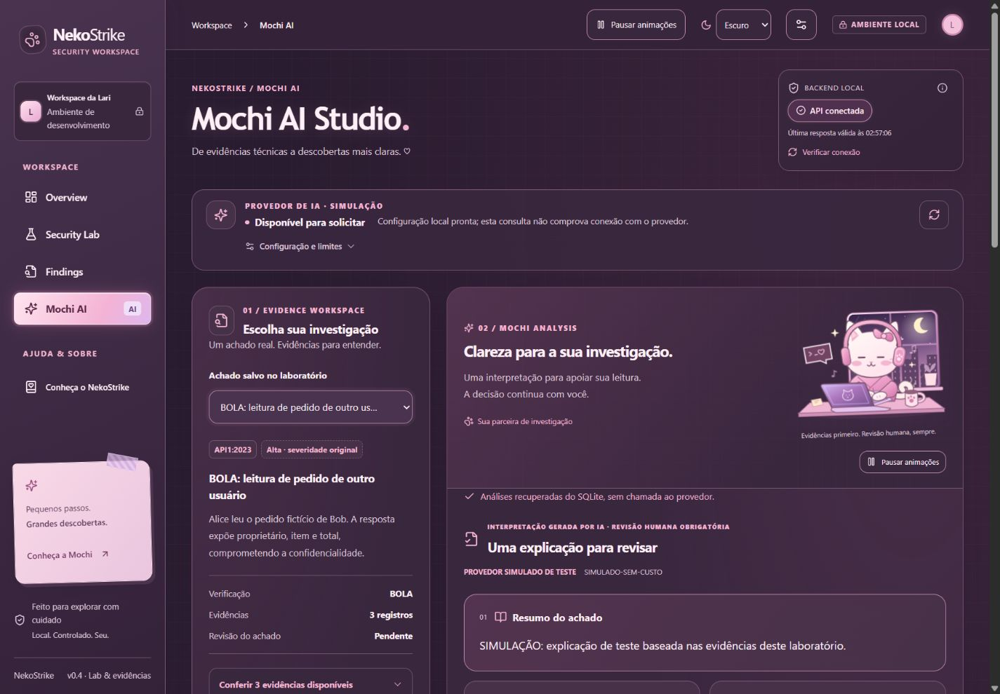
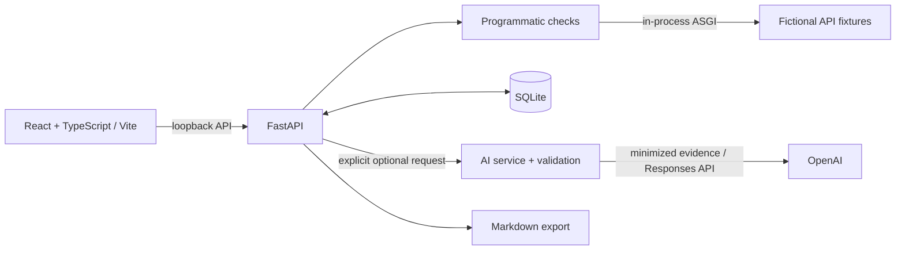

<div align="center">

# NekoStrike 🎀

**AI-Assisted Offensive Security Lab & Vulnerability Reporting**

A local security workspace that turns controlled API experiments into traceable
findings, optional AI explanations, and reviewable reports.

[English](README.md) · [Português](README.pt-BR.md) · [Installation](docs/portfolio/INSTALLATION.md) · [Validation & limitations](docs/portfolio/STATUS.md)

**Local MVP · Portfolio release candidate · AI disabled by default**

</div>



*Real application screenshot from a local simulated rehearsal, before the final RC26.1
spacing adjustments. This is not a live AI service or a newly completed visual QA run.*

## Overview

Security findings are more useful when another person can inspect the evidence behind
them. NekoStrike connects the full learning workflow: execute a controlled check,
compare vulnerable and corrected behavior, preserve the evidence, review the finding,
and export a report. Mochi AI can explain those facts without replacing the checker's verdict.

Built by **Larissa Albuquerque**, the project combines Python API engineering,
React/TypeScript, persistence, structured AI integration, and an original Sakura Cybercore
visual identity. The application interface is currently in Brazilian Portuguese.

## Features

- Three isolated API checks with vulnerable and corrected scenarios.
- Captured HTTP evidence, qualitative severity, recommendations, and negative controls.
- SQLite execution/finding history and explicit human review.
- Optional OpenAI Responses API integration with structured output and evidence validation.
- Saved analyses, reuse of current results, separate analysis review, and reported token usage.
- Deterministic Markdown export, with an optional appendix of saved AI analyses.
- Light/dark/system themes, keyboard controls, reduced-motion support, and original Mochi artwork.
- Automated backend/frontend tests and a mock-only rehearsal that requires no API key.

## Screenshots & reports

[View the screenshot gallery](docs/portfolio/SCREENSHOTS.md) for Overview, Security Lab,
Findings, and Mochi AI. Captures are app-only and dated; older layouts are explicitly
labeled. They do not certify the latest responsive matrix or animation performance.

See actual exports from the isolated simulated workspace:
[deterministic Markdown](docs/portfolio/examples/report.md) ·
[Markdown with saved simulated AI](docs/portfolio/examples/report-with-simulated-ai.md).
These are product-generated reports, not model-generated portfolio claims.

## How it works

**Explore → Investigate → Analyze → Document**

1. **Explore:** inspect the local workspace and choose a security scenario.
2. **Investigate:** run vulnerable/corrected cases and compare stored responses.
3. **Analyze:** inspect evidence yourself; optionally request or reopen a Mochi explanation.
4. **Document:** review findings and export Markdown. Exporting saved AI does not call a model.

## Architecture



The lab fixtures run **inside the process**, through ASGI transport. They are not
mounted as public vulnerable endpoints. The API is bound to loopback, and the frontend
proxies `/api` to `127.0.0.1:8000`. AI credentials are backend-only. Local source:
`frontend/`, `backend/app/`, `backend/tests/`, and `scripts/workspace.mjs`.

## AI integration

Mochi uses the official OpenAI SDK and Responses API with a Pydantic output schema.
Only an allowlisted projection of fictional evidence is sent. The backend validates
references against the selected finding; the client also validates returned contracts.
Verdict and severity remain deterministic. Schema validation cannot guarantee factual
correctness: **human review is required**.

Accepted analyses are stored in SQLite with source identity, review status, and usage
metadata when reported. Reopening history does not generate a new response. Current
saved results can be reused; unreadable history does not silently trigger another purchase.

Generation is **optional and disabled by default**. Controls include one in-flight
analysis, a timeout, bounded input/output, cooldown, an attempt limit per process, and
no automatic provider retries. Limits are not a financial budget and reset on process
restart. Token counts are not verified billing. See [AI setup and boundaries](docs/portfolio/AI.md).

## Security lab

| Check | Vulnerable behavior | Corrected behavior |
| --- | --- | --- |
| BOLA / API1:2023 | Alice reads Bob's fictional order | Ownership authorization denies access with 403 |
| Data exposure / API3:2023 | Public profile includes private fields | Only allowed public fields are returned; both cases use 200 |
| Misconfiguration / API8:2023 | Simulated error exposes fictional diagnostics | Generic error response; both cases use 500 |

Severity is qualitative and scenario-specific. There is no invented CVSS score.
Repeated vulnerable runs create separate records, not distinct vulnerabilities.
“Reviewed” means a person checked the evidence; it does not mean “fixed.”

## Installation

Validated environment: **Windows 11, Python 3.12.14, Node 26.13.0/npm 11.20.0**.
Python 3.12 is required by the setup helper. Node must support direct TypeScript
execution for the test suite; use the validated version for reproduction. Other
OS/runtime combinations are not claimed as tested.

```powershell
git clone https://github.com/anjennlical/nekostrike.git
cd nekostrike
node scripts/workspace.mjs setup --python "C:\path\to\Python312\python.exe"
node scripts/workspace.mjs check
node scripts/workspace.mjs start
```

Open **http://127.0.0.1:5173/#overview**. Ctrl+C stops the launcher.
On Windows, `Abrir NekoStrike.cmd` starts the same command after setup.
No OpenAI account, `.env`, or API key is required for the lab, persistence, review,
or deterministic reports. The first launch starts with an empty local database.

[Complete setup, manual commands, and troubleshooting](docs/portfolio/INSTALLATION.md)

## Running tests

```powershell
# From the repository root: backend, dependencies, frontend, build, format and local demo
node scripts/workspace.mjs check

# Backend separately
.\.venv-independent\Scripts\python.exe -m pytest -c backend/pytest.ini backend/tests

# Frontend separately
cd frontend
npm test
npm run build
npm exec prettier -- --check src tests vite.config.ts
```

The candidate has **189 passing tests: 126 backend + 63 frontend**. The suite blocks
real provider transport and uses temporary databases. This count is not a coverage
percentage, browser E2E certification, or proof of security. See [validation status](docs/portfolio/STATUS.md).

## Limitations & ethics

- A local educational MVP, not a production scanner or a security certification.
- No arbitrary URL targets, external scanning, public backend hosting, or visitor-funded AI.
- Loopback, host/CORS checks and workspace headers are not user authentication.
- Single-process AI limits; no multi-user or multi-worker financial enforcement.
- AI can be wrong; validation and preserved evidence support review, not infallibility.
- Full current visual/responsive acceptance, screen-reader/device checks and another-machine validation remain pending.
- Markdown export is implemented; product PDF export is not.

Only use the built-in fictional laboratory. Do not expose this backend or its AI
endpoints to the internet. A future hosted demo needs a separate security design.
Read [security boundaries](SECURITY.md).

## Author, rights & project status

**Larissa Albuquerque — [@anjennlical](https://github.com/anjennlical)**.
Project direction and original Mochi identity by Larissa; development used Codex
assistance. Historical commit attribution is preserved in the publication preparation.

**Portfolio release candidate / local MVP (functional version 0.4.0, RC26.1).**
One real BOLA browser workflow was technically validated and persisted during an
explicitly authorized rehearsal. Its human semantic review remains pending; this
does not validate every checker with a live model. No new paid call was made for release preparation.

**No reuse license has been granted; rights reserved.** Public visibility does not
make this project open source. Code, Mochi artwork, and branding have separate rights
considerations. See [RIGHTS.md](RIGHTS.md) and [third-party notices](THIRD_PARTY_NOTICES.md).
