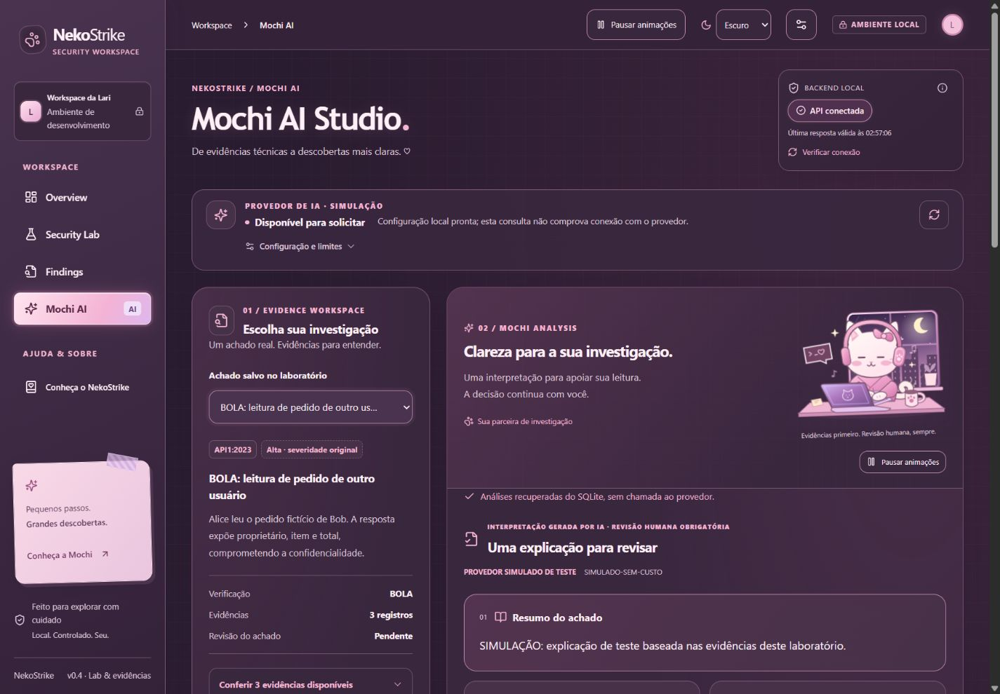

# NekoStrike 🎀

**AI-Assisted Offensive Security Lab & Vulnerability Reporting**

Um workspace local que transforma experimentos controlados de segurança de APIs em
achados rastreáveis, explicações opcionais por IA e relatórios revisáveis.

[English](README.md) · **Português** · [Instalação](docs/portfolio/INSTALLATION.md) · [Validação e limites](docs/portfolio/STATUS.md)

**MVP local · Candidato de portfólio · IA desativada por padrão**



*Captura real de ensaio local simulado, anterior aos ajustes finais de espaçamento
do RC26.1. Não representa serviço online nem nova aprovação visual.*

## Visão geral

O NekoStrike conecta execução de verificações, comparação entre cenários vulneráveis
e corrigidos, preservação de evidências, revisão humana e exportação. A Mochi pode
explicar os fatos sem substituir o veredito do verificador.

Criado por **Larissa Albuquerque**, reúne Python/FastAPI, React/TypeScript, SQLite,
integração estruturada com IA e identidade original Sakura Cybercore. A interface
do aplicativo está em português brasileiro.

## Funcionalidades

- Três verificadores internos, com cenários vulnerável/corrigido e controles negativos.
- Evidências HTTP, severidade qualitativa, recomendações e histórico SQLite.
- Revisão humana independente de achados e análises.
- OpenAI Responses API opcional, schema estruturado e referências verificadas.
- Persistência e reaproveitamento de análises atuais; tokens registrados quando informados.
- Markdown determinístico, com apêndice opcional de análises já salvas.
- Temas claro/escuro/sistema, teclado, movimento reduzido e mascote original.
- Testes automatizados e demonstração com provedor simulado, sem chave.

## Capturas e relatórios

A [galeria](docs/portfolio/SCREENSHOTS.md) apresenta Overview, laboratório, Findings
e Mochi. As imagens não contêm abas pessoais; capturas históricas estão identificadas.
Não são comprovação da matriz responsiva atual nem de performance das animações.

Exemplos realmente exportados pelo ambiente isolado:
[Markdown determinístico](docs/portfolio/examples/report.md) e
[Markdown com IA simulada salva](docs/portfolio/examples/report-with-simulated-ai.md).

## Como funciona

**Explorar → Investigar → Analisar → Documentar**

1. Escolha uma verificação no laboratório local.
2. Execute os dois cenários e compare as evidências persistidas.
3. Confira o achado; opcionalmente consulte ou solicite uma explicação da Mochi.
4. Revise e exporte Markdown. Exportar ou ler análises salvas não chama um modelo.

## Arquitetura

Frontend React/TypeScript/Vite → API FastAPI em loopback → verificadores internos
e SQLite. Os alvos fictícios rodam no processo via transporte ASGI e não são
endpoints vulneráveis expostos. A IA recebe uma projeção minimizada das evidências
somente em uma solicitação explícita. Credenciais ficam no backend.
Veja o [diagrama de arquitetura](README.md#architecture).

## Integração com IA

SDK oficial OpenAI, Responses API, schema Pydantic e validação de referências no
servidor e cliente. A IA não altera veredito, severidade nem marca revisão humana.
Validação estrutural não elimina alucinações: **a interpretação precisa de revisão**.

Resultados aceitos mantêm identidade da fonte, revisão e consumo quando informado.
Histórico indisponível não autoriza comprar outra resposta automaticamente. Há timeout,
limites de entrada/saída, cooldown, uma solicitação por vez e limite de tentativas
por processo. Não há retry automático. Esses controles não são orçamento financeiro
e reiniciar o processo reinicia a contagem. Tokens não comprovam cobrança.

Geração **opcional e desativada por padrão**. [Configuração e limites](docs/portfolio/AI.md).

## Laboratório

| Verificador | Vulnerável | Corrigido |
| --- | --- | --- |
| BOLA / API1:2023 | Alice lê o pedido fictício de Bob | Autorização por proprietário bloqueia com 403 |
| Exposição de dados / API3:2023 | Perfil público expõe campos privados | Apenas campos permitidos; ambos retornam 200 |
| Configuração insegura / API8:2023 | Erro simulado revela diagnóstico fictício | Erro genérico; ambos retornam 500 |

Severidade qualitativa, limitada ao cenário; sem CVSS inventado. Execuções repetidas
não são vulnerabilidades distintas. Revisado não significa corrigido.

## Instalação

Ambiente validado: **Windows 11, Python 3.12.14 e Node 26.13.0/npm 11.20.0**.
O setup exige Python 3.12. Use a versão validada do Node para reproduzir os testes,
que importam TypeScript diretamente. Outras combinações não estão certificadas.

```powershell
git clone https://github.com/anjennlical/nekostrike.git
cd nekostrike
node scripts/workspace.mjs setup --python "C:\caminho\Python312\python.exe"
node scripts/workspace.mjs check
node scripts/workspace.mjs start
```

Abra **http://127.0.0.1:5173/#overview**. Ctrl+C encerra o lançador. Depois do setup,
também é possível usar `Abrir NekoStrike.cmd`. Laboratório, histórico, revisão e
Markdown não exigem `.env`, chave ou conta OpenAI. A primeira execução começa vazia.

[Passo a passo completo e solução de problemas](docs/portfolio/INSTALLATION.md).

## Testes

```powershell
node scripts/workspace.mjs check
.\.venv-independent\Scripts\python.exe -m pytest -c backend/pytest.ini backend/tests
cd frontend
npm test
npm run build
npm exec prettier -- --check src tests vite.config.ts
```

**189 testes: 126 backend + 63 frontend.** A suíte bloqueia transporte real de IA e
usa bancos temporários. Não é percentual de cobertura, QA completo de navegador
ou certificação de segurança. [Estado da validação](docs/portfolio/STATUS.md).

## Limites e ética

Somente laboratório fictício interno. Sem alvos arbitrários, scanner externo ou
backend público. Loopback, CORS/hosts e headers não substituem autenticação. Limites
de IA são locais ao processo; não há operação multiusuário/multiworker segura para
consumo financeiro. Não disponibilize endpoints para visitantes gastarem créditos.

QA visual/responsivo completo, dispositivos físicos, leitor de tela e reprodução em
outra máquina seguem pendentes. PDF no produto não foi implementado. Uma futura demo
hospedada precisa de desenho de segurança próprio. [Limites de segurança](SECURITY.md).

## Autoria, direitos e estado

**Larissa Albuquerque — [@anjennlical](https://github.com/anjennlical)**.
Direção do projeto e identidade original da Mochi por Larissa; desenvolvimento com
assistência do Codex. A preparação preserva a atribuição histórica dos commits.

**Candidato de portfólio / MVP local, versão funcional 0.4.0, RC26.1.** Um fluxo BOLA
real pelo navegador foi validado tecnicamente e persistido mediante autorização.
A revisão humana da interpretação continua pendente. Isso não valida todos os
verificadores com IA real. Nenhuma chamada paga nova foi feita nesta preparação.

**Sem licença de reutilização; direitos reservados.** Repositório visível não é
automaticamente open source. [Direitos](RIGHTS.md) · [Dependências e avisos](THIRD_PARTY_NOTICES.md).
