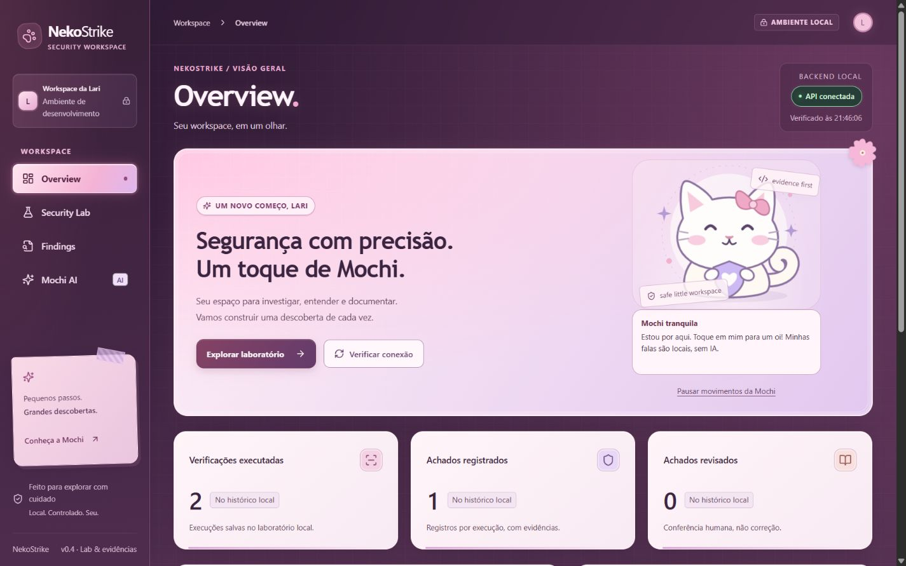
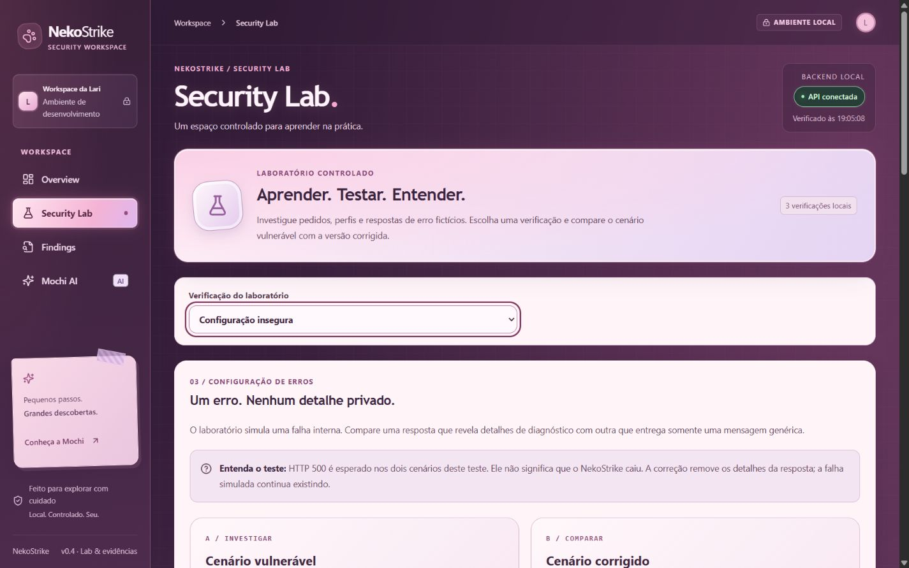
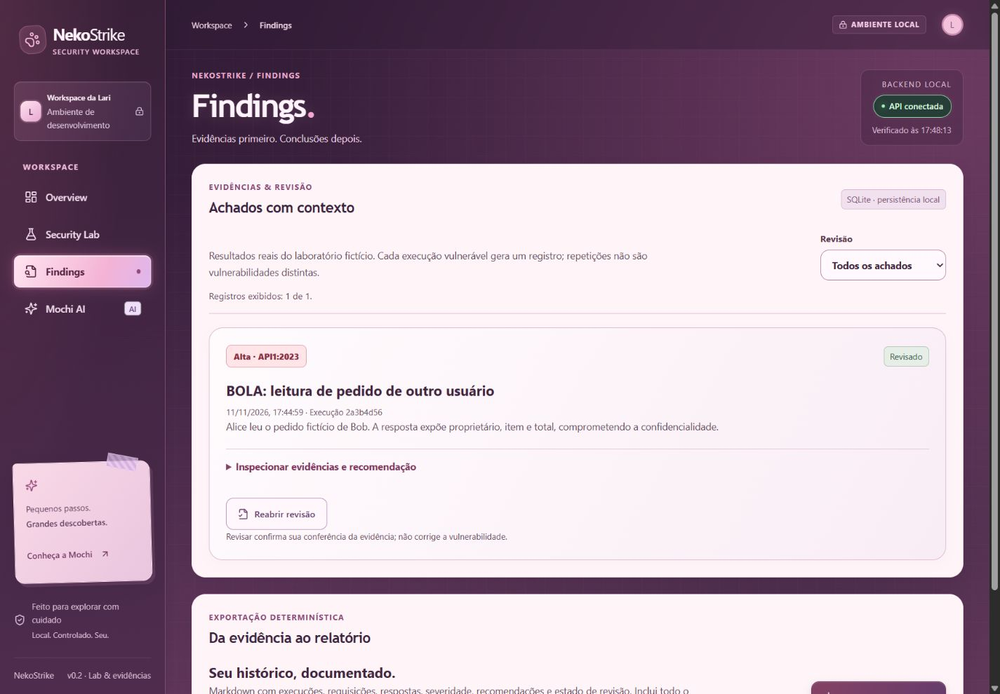
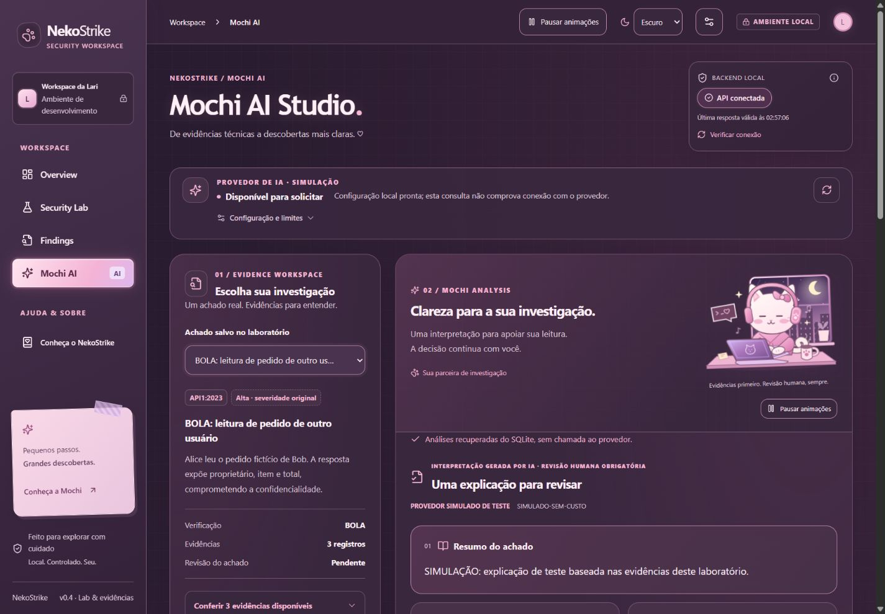

# Screenshots and report examples

[README](../../README.md) · [Português](../../README.pt-BR.md)

These are existing, visually inspected application-only captures. No personal
browser tabs, Windows notifications, credentials or unrelated applications are
included. Images are copied unchanged, not AI-generated or retouched. The app's
workspace name “Lari” is its authored UI identity.

The Overview/Lab/Findings captures are **historical, 11 November 2026**, before
later theme/layout refinements. The Studio capture is from **13 November 2026**,
before RC26.1 spacing changes, using a **simulated provider**. These are evidence
of implemented screens, not screenshots of a hosted service or final visual acceptance.

## Overview — historical capture

## Security Lab — historical capture

## Findings — historical capture

## Mochi AI Studio — simulated analysis

## Reports — actual exported Markdown

The product downloads Markdown; there is no separate PDF/report-preview screen to
fabricate. These examples were retrieved from the isolated mock workspace through
the application's real export endpoint, without a provider call:

- [Deterministic report](examples/report.md)
- [Report with saved simulated AI appendix](examples/report-with-simulated-ai.md)

All lab people, resources and evidence are fictional. The AI appendix is explicitly
simulated. An actual OpenAI explanation from the author's private history is not
included in these examples.

## Português

Capturas reais e limpas, copiadas sem alterações. Overview, Lab e Findings são de
11/11, anteriores ao acabamento atual. Mochi é de 13/11, antes do RC26.1, com IA
simulada. Não representam QA visual final nem aplicação hospedada. Os dois links
mostram Markdown realmente exportado do ambiente temporário; não há tela fictícia
de relatório ou PDF. Capturas recentes com abas pessoais e notificações foram excluídas.
